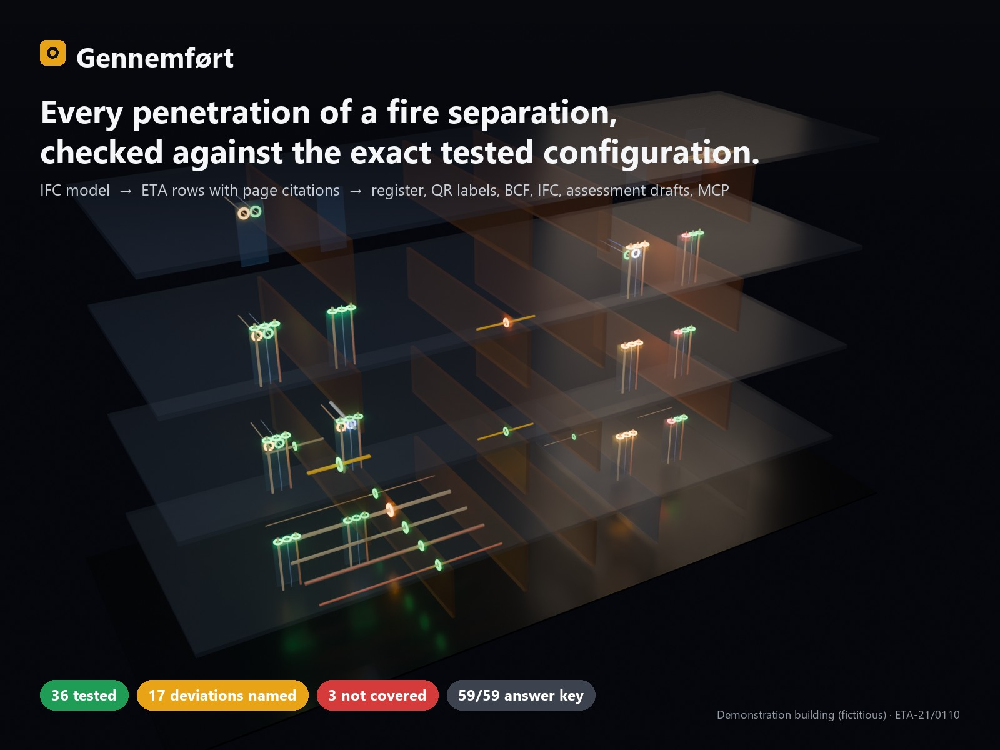
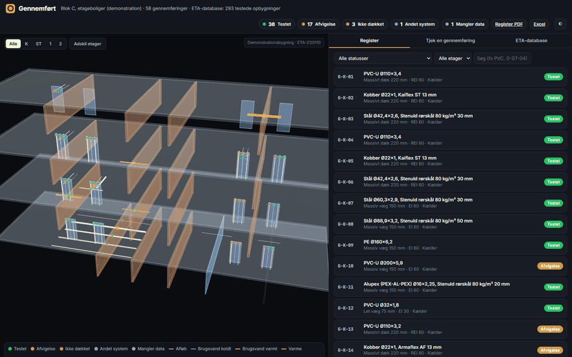
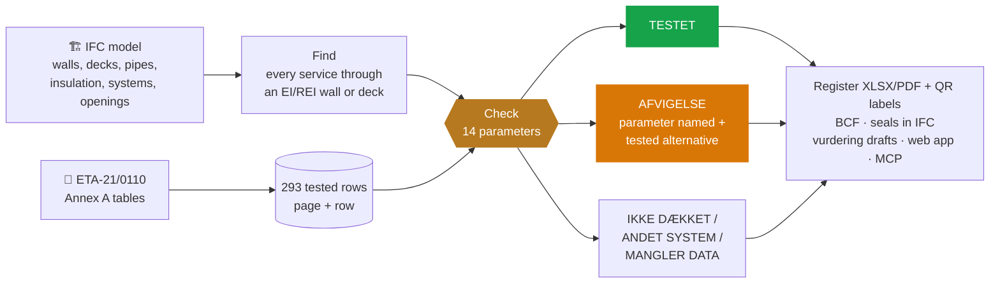
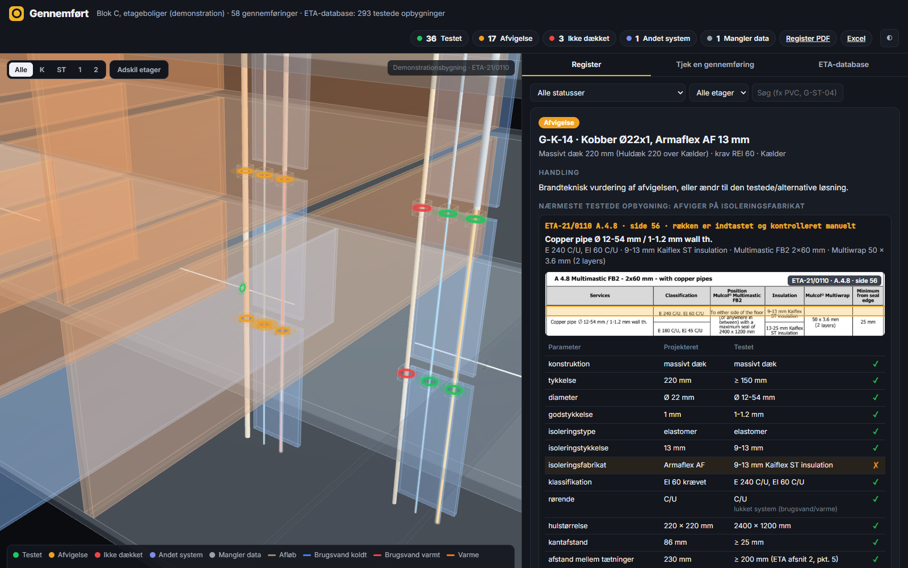
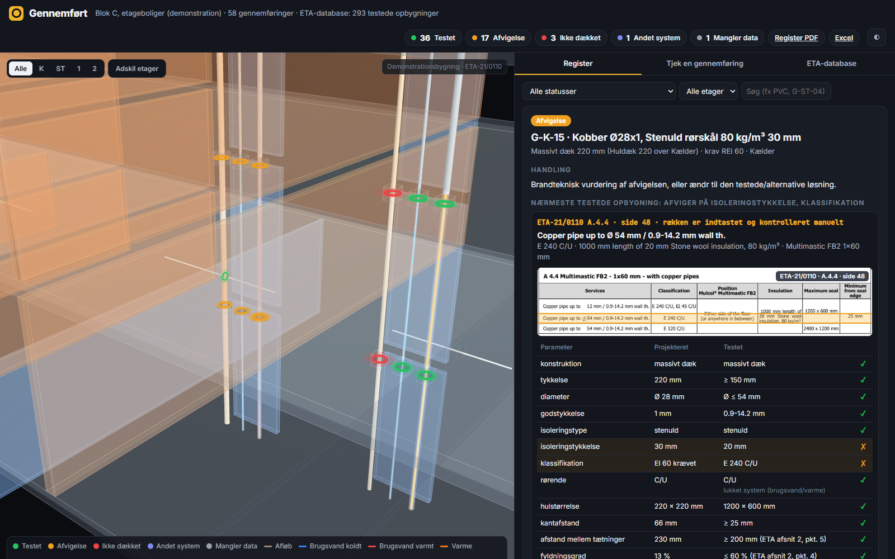
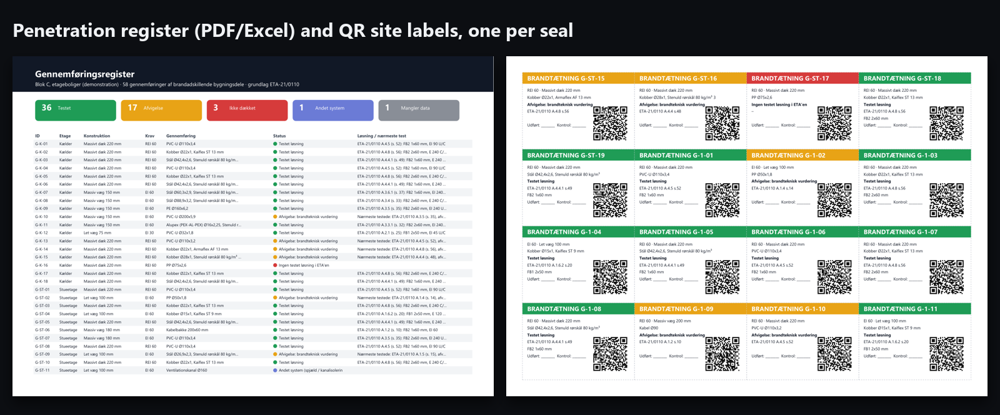
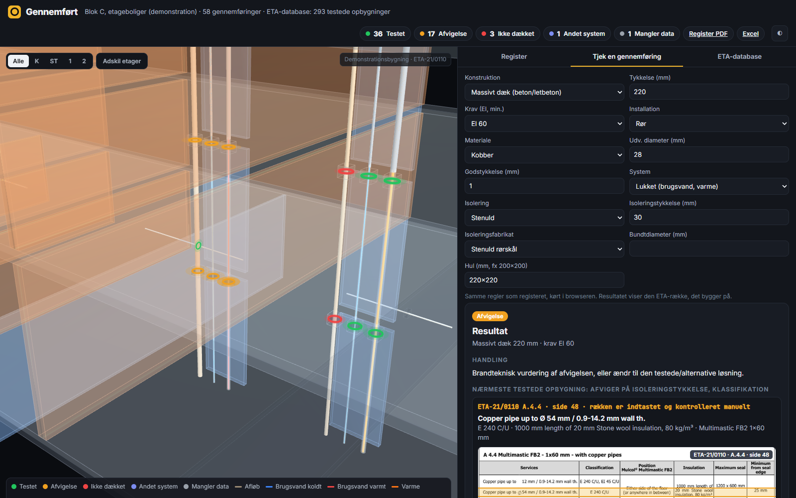
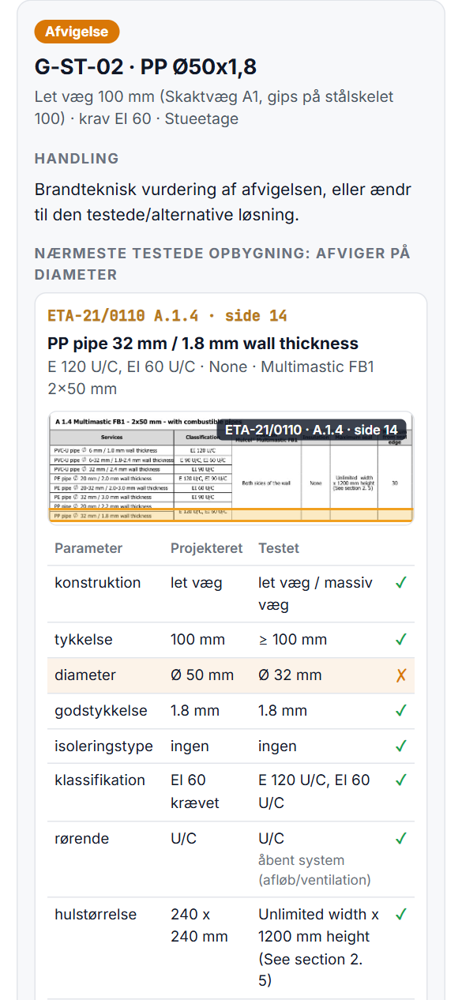

<div align="center">



# Gennemført

### Every penetration of a fire separation, checked against the exact tested configuration, with the page to prove it.

**[▶ Live app](https://abdullah13793-commits.github.io/gennemfoert/app/)** · **[Project page](https://abdullah13793-commits.github.io/gennemfoert/)** · **[Register PDF with QR labels](https://abdullah13793-commits.github.io/gennemfoert/app/downloads/Gennemfoeringsregister.pdf)**

       

</div>

> **Decision support, not approval.** Every solution is confirmed against the source document and the manufacturer's
> installation instructions; every brandteknisk vurdering is written and signed by a person. The demonstration
> building is fictitious.

## Valid only as tested

A penetration seal is approved for the set-up that was fire-tested: construction and thickness, pipe material,
diameter and wall thickness, insulation type, thickness and product, pipe-end configuration, seal geometry. Projects
drift in small ways, and the drift is usually found on site, one enquiry at a time. Gennemført finds it in the model.

<p align="center"></p>



## The answer, with the evidence beside it



Copper Ø22 with Armaflex AF 13 mm through a 220 mm hollow-core deck, REI 60. The nearest tested configuration is
**ETA-21/0110 A.4.8, page 56**: same pipe, same diameter, same insulation thickness, tested with Kaiflex ST. The
insulation product is the deviation, and it is the only one.



When changing one parameter would make it compliant, it says so: copper with 30 mm stone wool through the decks has no
EI 60 row (only E), the tested alternative is 9-13 mm elastomeric insulation with Multiwrap (A.4.8, EI 60).

**Checked per seal:** construction · thickness · material · diameter (incl. the ETA's intermediate-size graphs) · wall
thickness · insulation type, thickness and product · classification · pipe-end configuration (open/closed system) ·
hole size · edge distance · distance between seals (≥ 200 mm) · fill ratio (≤ 60 %).

## Documentation the owner can rely on



| Output | What's in it |
|---|---|
| **Register** (Excel + PDF) | ID, storey, construction, service, status, solution with ETA reference, deviations, inspection columns, indicative quantities |
| **QR site labels** | one per seal: status, ETA reference, sign-off fields; the QR opens the seal's card in the app |
| **IFC** | one `IfcBuildingElementProxy` (PROVISIONFORVOID) per seal, filling the architect's opening, with `Pset_ProvisionForVoid` and a `Gennemfoert_Taetning` set (status, solution, ETA ref, deviations, inspection fields) |
| **BCF 2.1** | one issue per seal that is not tested-as-built, service and host selected |
| **Brandteknisk vurdering drafts** (.docx) | basis with citations, designed-vs-tested table, deviations, tested alternative, the questions the adviser must answer, signature block; one per group of identical deviations |

## On site and on the phone

<table><tr>
<td width="62%"></td>
<td width="38%"></td>
</tr><tr>
<td>"Tjek en gennemføring": a phone enquiry answered in the browser, with the ETA row.</td>
<td>Scan the label on site: the seal's card opens.</td>
</tr></table>

## Ask it (MCP)

`src/mcp_server.py` exposes the engine to any MCP client: `check_penetration`, `search_eta`, `project_overview`,
`list_penetrations`, `get_penetration`, `export_documents`. A recorded live session
([`results/mcp_claude_demo.json`](results/mcp_claude_demo.json)): asked in Danish whether a 110×3.2 PVC drain through a
220 mm hollow-core deck at EI 60 is tested, Claude called `check_penetration` and answered AFVIGELSE on wall thickness
(A.4.5, p. 52), then listed the project's deviations with sections and pages, and noted that a person signs.

```json
{"mcpServers": {"gennemfoert": {"command": "python", "args": ["<repo>/src/mcp_server.py"]}}}
```

## The tested-solution database

`src/gennemfoert/eta.py` turns the Annex A tables of ETA-21/0110 (Mulcol Multimastic C System, ETA-Danmark, 2021,
publicly available) into **293 records from 38 tables**, each with page, section and the row's rectangle on the page.
Merged cells are filled down; rows that the PDF text layer garbles (pages 23, 48-50, 56) were typed from the rendered
page and are marked `source: override` in [`data/eta/overrides.json`](data/eta/overrides.json). The ETA PDF itself is not
in this repository; see [`data/eta/source/README.md`](data/eta/source/README.md).

## Proof

| Check | Result |
|---|---|
| Demonstration model: hand-written answer key (status, deviating parameter, tested alternative) | **59/59**, 0 extra penetrations |
| Enquiries derived by hand from the ETA pages | **18/18** |
| Browser engine vs Python engine, random enquiries | **600/600** identical |
| Write-back | 58 seals with Psets filling their openings; 22 BCF issues parse |
| MCP | all tools through the official client; live Claude session recorded |
| Tests | 24/24 (`python -m pytest tests`) |

Demonstration result: 58 penetrations, 36 tested as built, 17 deviations (each named), 3 not covered, 1 duct (other
system), 1 with missing data; one crossing of an unrated partition correctly ignored.

## Where it fits

| Tool | Strong at | Gennemført adds |
|---|---|---|
| Revit firestop plug-ins (e.g. Hilti) | Detect penetrations, place one manufacturer's firestops in Revit | Open IFC from any tool, any brand's ETA, the evidence row per seal |
| Manufacturer selectors | Tested solution in one range | The whole project at once, deviations named, alternatives |
| Model checkers (e.g. Solibri) | Penetrations without a fire-seal object | Whether the seal is valid as tested, and why not |
| Documentation tools | Photos and sign-off of installed seals | Register, labels and evidence before installation |

Honest gaps and roadmap: [docs/POSITIONING.md](docs/POSITIONING.md). Case study: [docs/CASE_STUDY.md](docs/CASE_STUDY.md).

## Run it

```bash
pip install -r requirements.txt
cd src
python -m gennemfoert.eta          # ETA PDF -> data/eta/records.json (needs the PDF, see data/eta/source)
python -m gennemfoert.model        # demonstration IFC + answer key
python -m gennemfoert.pipeline     # detect -> check -> results/register.json (+ answer-key evaluation)
python -m gennemfoert.writeback && python -m gennemfoert.register && python -m gennemfoert.assess && python -m gennemfoert.export_web
cd .. && python -m pytest tests
python src/mcp_server.py           # MCP over stdio
```

<sub>Tested configurations: ETA-21/0110, Mulcol Multimastic C System (ETA-Danmark A/S, 2021); table excerpts shown for citation, the complete document is the reference. The demonstration building and its installations are fictitious.</sub>
