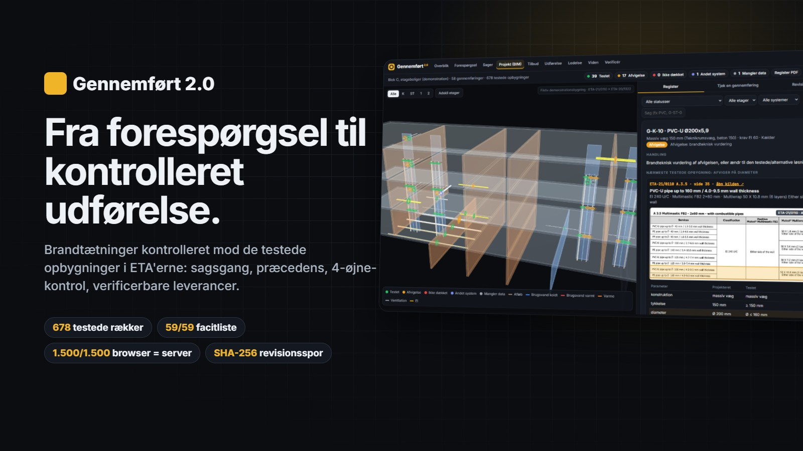
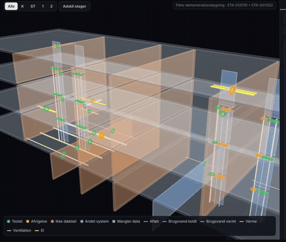
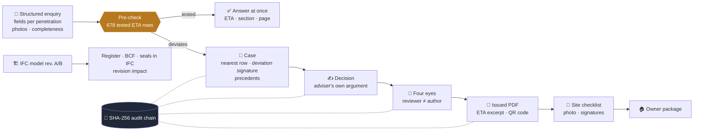

<div align="center">



# Gennemført 2.0

### Penetration seals, valid as tested: from the customer's enquiry to the owner's handover, every step checked and verifiable.

**[▶ Open the app](https://abdullah13793-commits.github.io/gennemfoert/v2/)** · **[Project page + 60-second tour](https://abdullah13793-commits.github.io/gennemfoert/)** · **[Verify a file](https://abdullah13793-commits.github.io/gennemfoert/v2/verify.html)** · [Version 1](https://abdullah13793-commits.github.io/gennemfoert/app/)

[](https://github.com/abdullah13793-commits/gennemfoert/actions/workflows/tests.yml)
      



</div>

> **Decision support, not approval.** Every match is confirmed against the source document and the installation instructions; a brandteknisk
> vurdering is written and signed by a person. The demo building, cases, customers and precedents are fictitious.

## What it does
A fire-protection adviser answers enquiries about penetration seals: is this pipe, in this wall, at this fire rating, a tested solution,
and if not, what is the assessment? Gennemført 2.0 turns that work into a checked, traceable workflow.



| Module | | Try it |
|---|---|---|
| **M1 Knowledge base** | ETA-21/0110 board seals (293 rows) + ETA-20/1322 fire collars (385 rows, 12 mounting situations); page images with the row highlighted; known source errors listed | [Viden](https://abdullah13793-commits.github.io/gennemfoert/v2/viden.html) |
| **M2 Structured intake** | Replaces the free-text form: completeness score, photo checklist, live pre-check, routing east/west, SLA | [Forespørgsel](https://abdullah13793-commits.github.io/gennemfoert/v2/forespoergsel.html) |
| **M3 Case workflow** | States, deadlines, the adviser's own argument, four-eyes review, hash-chained log verified in the browser | [Sager](https://abdullah13793-commits.github.io/gennemfoert/v2/sager.html) |
| **M4 Precedents + issue** | Deviation signature → earlier decisions; issued PDF with verification code and QR | [Verificér](https://abdullah13793-commits.github.io/gennemfoert/v2/verify.html) |
| **M5 Quote** | Material list with the wholesaler's item numbers and the basis on every line | [Tilbud](https://abdullah13793-commits.github.io/gennemfoert/v2/tilbud.html) |
| **M6 Execution** | Checklist from the ETA row, photo, signatures, inspector ≠ installer, owner package | [Udførelse](https://abdullah13793-commits.github.io/gennemfoert/v2/udfoerelse.html) |
| **M7 Revisions** | IFC revision diff by GlobalId; decisions that no longer hold | [Projekt](https://abdullah13793-commits.github.io/gennemfoert/v2/projekt.html#revision) |
| **M8 Dashboard** | Deflection rate, missing info, lead time, recurring deviations | [Ledelse](https://abdullah13793-commits.github.io/gennemfoert/v2/overblik.html) |
| **M9 MCP** | 14 tools for Claude, Copilot or IDE agents | `src/mcp_server.py` |

## Verifiable by design
Every output can be checked by a person and is checked automatically on every push ([`docs/VERIFY.md`](docs/VERIFY.md)):

- **The file:** [`MANIFEST.json`](docs/v2/data/manifest.json) holds the SHA-256 of each deliverable, the step that produced it, the
  model, knowledge-base and code versions, and the tests that cover it. Drag a file onto [Verificér](https://abdullah13793-commits.github.io/gennemfoert/v2/verify.html):
  it is hashed in your browser and never uploaded.
- **The answer:** every verdict cites ETA, section and page, shows the page with the tested row highlighted, and links to the official PDF at
  that page.
- **The method:** `python -m gennemfoert.reproduce` rebuilds everything from the source model and compares it with what's published (9/9).

## Results
| | |
|---|---|
| Answer key, hand-derived from the ETA pages | **59/59** in board-only mode and full range |
| Demo register (58 penetrations) | 39 tested (30 board seals, 9 fire collars), 17 deviations named by parameter, 1 duct, 1 missing data |
| Browser engine vs Python engine | **1,500/1,500** random enquiries identical, every check's text; 384/384 intake items |
| Workflow simulation (30 fictitious cases) | 35 % answered at intake, 20 % missing info caught before an adviser, median 2.7 days, 30/30 audit chains intact |
| Revision B | 52 unchanged, 1 added, 1 removed, 5 changed: all flagged for re-assessment |
| Tests | **42 passing**, incl. an end-to-end browser run: enquiry → decision → refused self-review → review → sent |

## Run it
```bash
pip install -r requirements.txt && python -m playwright install chromium
cd src
python -m gennemfoert.pipeline        # IFC -> verdicts (+ answer key)
python -m gennemfoert.demo            # cases, precedents, issued PDFs
python -m gennemfoert.export_web && python -m gennemfoert.manifest && python -m gennemfoert.reproduce
cd .. && python -m pytest tests
```
MCP client config: `{"mcpServers": {"gennemfoert": {"command": "python", "args": ["<repo>/src/mcp_server.py"]}}}`

More: [SPEC](SPEC.md) · [Case study](docs/CASE_STUDY.md) · [Positioning](docs/POSITIONING.md) · [Verification](docs/VERIFY.md) ·
Companion product: [**Isoleret**, technical insulation with a fire cross-check](https://github.com/abdullah13793-commits/isoleret)

MIT licence. ETA documents are the manufacturer's public documents, linked, not redistributed.
